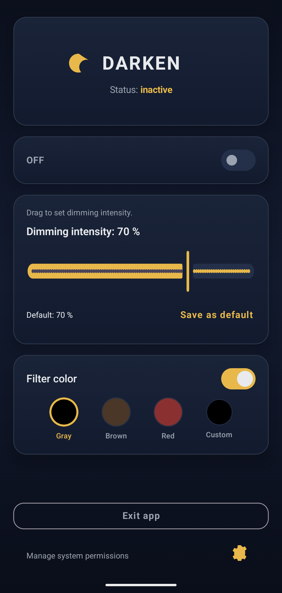
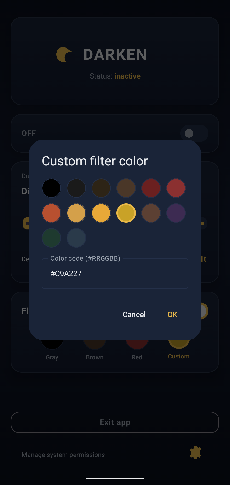

# Darken

Darken 是一款免费的开源 Android 应用，可通过全屏覆盖层调暗屏幕。无广告、无分析功能，也不需要 Internet 权限。

## 为什么开发这个应用

我一直没能找到一款真正现代、开源并且能把这件事做好用的 Android 应用——一款保持更新、简单易用，并且能方便访问所有基本功能的应用。因此，我为自己开发了这个简洁的工具：它只专注于完成自己的工作，不加入不必要的复杂功能。

最新版本的 Android 系统已经集成了类似的“额外调暗”（extra dim）功能，这是你能使用的最佳、最安全的解决方案，我们完全推荐使用它。不过，如果系统亮度对你来说仍然太高，或者你希望使用自定义颜色滤镜等额外功能，那么你可能会喜欢这款应用。

| | |
|:---:|:---:|
|  |  |

## 功能

- 可调节调暗强度（0–99%）
- 滤镜颜色：灰色、暖棕色、红色，或自定义调色板 / 十六进制颜色
- 快捷设置磁贴：无需打开应用即可切换调暗功能
- 覆盖层启用时，可选交互式通知控件
- 简洁的开启/关闭小组件
- 支持捷克语、英语和简体中文界面
- 设置仅存储在设备本地（DataStore）
- 覆盖层启用时显示简洁的前台通知（Android 13+）

## 要求

- Android 12+（API 31+）
- **显示在其他应用上层**权限（覆盖层）
- Android 13+ 需要开启**通知**（用于显示服务图标）

## 证书指纹（不包括 F-Droid 版本）

SHA256: 19:7F:C8:BF:5A:D8:A8:E9:D0:76:CD:5B:DB:7C:9F:BA:98:32:42:01:BD:8A:5E:30:FC:FD:ED:93:15:F0:85:D7

## 隐私

请参阅 [PRIVACY.md](PRIVACY.md)。应用内的隐私政策使用相同内容（设置 → 隐私政策）。

## 权限（用途）

| 权限 | 用途 |
|------------|---------|
| 显示在其他应用上层 | 绘制调暗覆盖层 |
| 前台服务 | 让覆盖层在后台持续运行 |
| 通知（Android 13+） | 显示简洁的服务通知 |
| 忽略电池优化 | 可选；降低系统停止服务的风险 |

应用不使用 Internet。覆盖层权限功能强大；本项目完全开源，行为可以被审查。

## 已知限制

目前没有具体的已知问题，但由于 Android 和各厂商系统之间存在差异，应用在不同设备上的行为可能有所不同（尤其是 Samsung UI、HyperOS 以及高度定制的系统）。如果你遇到任何异常，欢迎反馈，这有助于改进兼容性。

### 对安全敏感的应用

一些安全敏感的应用（例如银行应用、密码管理器或身份验证 / 双重身份验证应用）可能会在覆盖层启用时限制或阻止交互。这是它们为防止屏幕覆盖攻击而采取的安全措施。

如果你在此类应用中遇到异常行为，请尝试停用覆盖层。

本应用按“现状”提供，具体行为可能因设备和 Android 版本的系统级差异而有所不同。

## 第三方库

AndroidX / Jetpack Compose / DataStore（Apache License 2.0），已链接到应用二进制文件中。

## 开发者说明

代码在 **[Cursor](https://cursor.com)**（AI 辅助 IDE）的帮助下编写。感谢 Cursor 团队以及背后的模型。文档也在 [ChatGPT](https://chatgpt.com) 的帮助下进行了更新。

## 更多信息

- **仓库：** https://github.com/lokomaster1/darken
- **联系方式：** diskus.barge163@simplelogin（点）com
- **许可证：** [GNU GPL v3.0 或更高版本](LICENSE) — 版权所有 (C) 2026 lokomaster1
